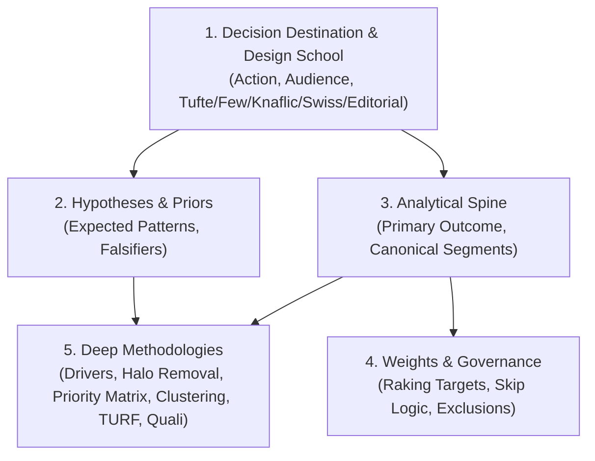

# `/dps-grill` & `/dps-clarify` — Relentless Data Grilling & Objective Discovery

Interview the user relentlessly until you reach a shared understanding of the research objective, stakeholder hypotheses, and **Analytical Spine**. Adapts Matt Pocock's `grilling` and `domain-modeling` disciplines to survey and market research analysis.

Map the discovery session as a **Design Tree**: every decision branches into the downstream analytical decisions that hang off it.

---

## 1. Fact Reconnaissance First (Never Ask the User for Facts)

Finding *facts* from the environment is your job, never the user's. Before asking Round 1, silently inspect the dataset and workspace:

```bash
python3 .dps/scripts/quant_analyzer.py <data_file> --profile -o .dps/outputs/setup/
```

Extract and hold these concrete facts before speaking:
- **Sample size ($N_{\text{total}}$)** and valid response counts ($n_{\text{valid}}$) per column.
- **Detected variable topology:** Numeric scales (0–10 NPS, 1–5 Likert), single-choice (`RU`), multiple-response (`RM` column groups sharing a prefix), open-ended verbatim columns, and metadata columns.
- **Data quality signals:** Variables with $>10\%$ missingness (`Article 6c`), preliminary **Straight-Lining** rates (`Article 6a`), extreme skewness ($|\text{skew}| > 2$), or mutually exclusive `0x0` **Branching Overlap** pairs (`Article 7c`).
- **Existing weights:** Whether a `weight` / `peso` / `fator` column exists or whether sample demographics deviate from obvious population splits.

Never ask: *"What columns are in your dataset?"* or *"How many respondents answered?"* State what you found and ask only for **decisions** and **domain context** that live in the user's head.

---

## 2. The 5-Branch Analytical Design Tree

Every survey or data analysis effort hangs on five branches. Prerequisites settle top-down:



1. **Branch 1 — Decision Destination & Data Design School:** What concrete Monday-morning action, budget allocation, product change, or campaign pivot rides on this report? Who reads `final_report.html`, and which of the 5 **Data Design Schools** ([`references/design-schools.md`](design-schools.md)) fits that audience best:
   - **`tufte`** (*Edward Tufte* — Default): Academic, scientific, public-policy, or deep research reports (ivory `#fffff8`, Palatino serif, 58%/36% floating Margin Notes, Booktabs, Cleveland dot plots).
   - **`few`** (*Stephen Few*): Operational BI and KPI performance monitoring (100% full-width perceptual grid, **Bullet Graphs** with target bands, inline diagnostic strips).
   - **`knaflic`** (*Cole Nussbaumer Knaflic / Storytelling with Data*): C-level executive action decks (decluttered white canvas, greyed-out context + single bold focal color `#1e40af`/`#ea580c`, Action-Title banners).
   - **`swiss`** (*Swiss Grid / Jacques Bertin*): Design-forward manifestos, urban/demographic studies, and multivariate matrices (exposed `1.5px`/`4px` black modular grid, Neo-Grotesque sans, Bertin retinal symbols).
   - **`editorial`** (*The Economist / FT Editorial*): Market research publications, public polling, and press deliverables (warm newsprint `#fcf8f2`, signature `6px` crimson top bar `#e3120b`, Kicker + Headline + Standfirst, lollipop charts).
2. **Branch 2 — Hypotheses & Priors:** What do stakeholders *believe* is true before seeing the data? What specific quantitative gap or anomaly would falsify their prior and shock the room?
3. **Branch 3 — Analytical Spine:** Which variable is the primary dependent outcome (e.g., NPS, Churn Risk, Overall Satisfaction, Vote Intention, Average Spend)? Which 1–3 categorical variables form the canonical **Segments** (banners) in the `/dps-setup` manifesto?
4. **Branch 4 — Weights & Governance:** Is this an unweighted sample (`weight = 1.0`) or does it require **Raking (IPF)** (`scripts/weighting.py`) against census/universe targets? Are high-missingness columns intentional survey skip branches or fieldwork dropouts?
5. **Branch 5 — Deep Methodologies:** Given Branches 1–3, which deep modules in `/dps-advanced` and `/dps-inject-open` earn their keep?
   - **Pure Sentiment Stack** (**Ipsative Centering** + **Halo Residual**) when respondents rate $\ge 4$ scale attributes susceptible to halo inflation.
   - **Priority Matrix & Pain Curves** when the user must rank operational investments by Derived Importance $\times$ Performance Gap.
   - **Causal Drivers & Expectation Residuals** when predicting the primary outcome and isolating *Disappointed* vs *Delighted* segments.
   - **Dual Clustering** (**K-Means** Personas + **DBSCAN** Outliers / **Gower Distance**) when discovering natural behavioral personas.
   - **Multi-Pass PCA / Factor Analysis + Cronbach's $\alpha$** when reducing large attribute batteries into latent constructs.
   - **TURF** when optimizing unduplicated reach across multi-response (`RM`) channels, products, or events.
   - **Qualitative Injection** (`/dps-inject-open`) when open-ended text columns are present to explain *why* segments diverge.

---

## 3. Working the Tree in Frontier Rounds

Work the tree in **rounds**. The **frontier** is every decision whose prerequisites are already settled: the questions you can ask *now* without guessing at answers you haven't heard yet.

Ask the whole frontier in one round (typically 3–5 concrete questions in Round 1). Number each question, ground it in specific numbers/columns from **Fact Reconnaissance**, and provide your recommended answer (`➡️`) worded so `"yes"` accepts it. Then wait for the user's answers before computing the next round.

### Round Formatting Template

```markdown
### 🔍 Fact Reconnaissance Summary
- **Dataset:** `{filename}` ($N = {total_n}$ respondents, `{n_cols}` variables)
- **Candidate Outcomes:** `{col_a}` (Mean = {val}, Skew = {skew}), `{col_b}` (NPS = {nps})
- **Candidate Segments:** `{seg_1}` ({k} groups), `{seg_2}` ({m} groups)
- **Quality & Branching Signals:** `{col_x}` has {pct}% missingness (probable skip branch after `{col_y}`); {sl_count} straight-liners detected on the 8-item rating battery.

---

❓ **Q1** - **Decision Destination, Primary Outcome & Data Design School**: Your dataset tracks both `{col_a}` (0–10 recommendation, preliminary NPS = {nps}) and `{col_b}` (return intention, {pct}% "Yes"). If this report drives resource allocation for the next edition, should we lock `{col_a}` (NPS) as the primary dependent outcome and render the report in the **Edward Tufte (`tufte`)** school (or would you prefer `knaflic` Storytelling with Data, `few` Perceptual Bullet-Graph BI, `swiss` Modular Grid, or `editorial` Economist/FT style)?

➡️ **Yes** — lock `{col_a}` (NPS segments: Promoters / Passives / Detractors) as the primary outcome and use the **Edward Tufte (`tufte`)** Data Design School (`design_school: tufte`).

---

❓ **Q2** - **Canonical Manifesto Segments (Analytical Spine)**: `{seg_1}` (Resident vs. Tourist, $n={n1}$ vs. $n={n2}$) and `{seg_2}` (Age brackets, 5 levels) show the largest preliminary variance in spend ($\Delta = \text{R\$ } 42.50$). Should we define `{seg_1}` and `{seg_2}` as the canonical manifesto segments in `/dps-setup`?

➡️ **Yes** — anchor `/dps-setup` on `{seg_1}` (Origin) and `{seg_2}` (Age Group) as the primary analytical banners.

---

❓ **Q3** - **Stakeholder Priors & Falsifiers**: Preliminary ratings on the 12 infrastructure items average 8.4/10 (strong positive halo), but `{infra_1}` (Parking, Mean = 6.1) and `{infra_2}` (Restroom Cleanliness, Mean = 6.4) lag behind. Do stakeholders suspect infrastructure bottlenecks are silently dragging down overall NPS among Tourists, and should we run the **Pure Sentiment Stack** (Ipsative + Halo Removal) and **Priority Matrix** to isolate the true operational drags?

➡️ **Yes** — test the Tourist infrastructure bottleneck hypothesis and run Halo Removal + Priority Matrix on the 12 rating items.

---

❓ **Q4** - **Weighting & Branching Governance**: No explicit weight column was found, and `{col_x}` (Neighborhood) is 100% missing whenever `Origin = Tourist` ($n={n2}$). Should we initialize uniform weights (`weight = 1.0`) and codify `Neighborhood` as a Resident-only branched variable ($n_{\text{valid}} = {n1}$)?

➡️ **Yes** — use unweighted sample inference (`weight = 1.0`, reporting 95% CI MoE) and restrict `Neighborhood` crosses to the Resident sub-sample ($n={n1}$).
```

---

## 4. Inline Domain Modeling & Artifact Persistence

During **Data Grilling**, actively sharpen the domain vocabulary (`domain-modeling`):
- **Challenge fuzzy terms:** If the user says *"satisfaction"*, ask whether they mean the 0–10 NPS recommendation scale, the expectations categorical question, or the composite mean of the 12 service items.
- **Probe edge cases:** Point out small cells ($n < 30$ triggering non-parametric tests per `Article 5` and raw-count qualitative rules per `Article 4`) and confirm whether tiny categories should be merged (`r014`).
- **Write artifacts inline as decisions settle:**
  1. `.dps/outputs/setup/column_mapping.json` — Maps every raw column header to a clean `snake_case` identifier (`Article 7a`).
  2. `.dps/outputs/00_data_glossary.md` — Documents the project's canonical terms, outcome definitions, segment definitions, and branching rules.
  3. `.dps/outputs/clarify_notes.md` — Records the settled **Design Tree** decisions, stakeholder hypotheses, weighting posture, and selected `/dps-advanced` modules.

---

## 5. Completion Criterion

The **Data Grilling** session is complete when the **frontier** is empty (all 5 branches of the **Design Tree** settled), `column_mapping.json`, `00_data_glossary.md`, and `clarify_notes.md` are saved, and the user confirms shared understanding. Immediately offer to run `/dps-setup` to lock the **Analytical Spine**.
