# `/dps-cross [VarX] x [VarY]` — Tufte Crosstab & Hypothesis Test

Slices two variables into a self-explanatory **Booktabs Table** with `N`, `±MoE% (95% CI)`, automatic assumption-checked statistical testing, **Standardized Residual** anomaly detection ($|z_{ij}| \ge 1.96$), visual chart, and interpretive **Margin Note**.

---

## 1. Pipeline

```
Data + VarX + VarY → scripts/crosstabs.py → cross_{X}_{Y}.csv + cross_{X}_{Y}_residuals.csv + cross_{X}_{Y}_stats.json + cross_{X}_{Y}_report.md
```

---

## 2. Execution Steps

1. **Validate Branching Overlap (`Article 7c`, `survey_branching_validation.md`):**
   - Compute the valid intersection $N_{X \cap Y}$ before building the contingency or group table.
   - If $N_{X \cap Y} = 0$ (`0x0` overlap), halt immediately and report:
     `> **Margin Note — Branching Gate:** Zero sample overlap (N=0) between {VarX} and {VarY}. Respondents sit on mutually exclusive survey skip branches.`
2. **Execute Deterministic Crosstab Engine:**
   ```bash
   python3 .dps/scripts/crosstabs.py <data_file> --index "<VarX>" --columns "<VarY>" --output .dps/outputs/cross/
   ```
3. **Run Invisible Agent Loop (Statistician $\rightarrow$ Critic $\rightarrow$ Tufte Designer):**
   - **Stage 1 — Statistician:**
     - Checks group/cell sample sizes ($N \ge 30$ per `Article 5`), Shapiro-Wilk normality ($p \ge 0.05$), skewness ($|\text{skew}| \le 2$), and expected cell counts ($E_{ij} \ge 5$).
     - **2 Categorical Variables:** Computes row percentages (`normalize='index'` for group comparison per `r035`) and column percentages (`normalize='columns'` for composition per `r036`) with `±MoE% (95% CI)` (`Article 1`). Runs $\chi^2(df, N) = \text{val}, p = \text{val}$ (or **Fisher's Exact Test** if $2\times 2$ and any $E_{ij} < 5$ per `r014`), **Cramér's $V$**, and **Standardized Residuals** $z_{ij} = (O_{ij} - E_{ij}) / \sqrt{E_{ij}}$ (`new_methodologies.md`). Flags every cell with $|z_{ij}| \ge 1.96$ as a statistically significant local anomaly.
     - **1 Categorical $\times$ 1 Continuous/Scale Variable:** Reports Group `N`, `Mean ± SD`, `95% CI`, `Median`, `IQR`, and `MAD`. Runs Welch's $t$-test + **Cohen's $d$** (2 groups, normal, $n \ge 30$), **Mann-Whitney $U$** + rank-biserial $r$ (2 groups, non-normal or $n < 30$), One-Way **ANOVA $F$** + $\eta^2$ (3+ groups, normal, $n \ge 30$), or **Kruskal-Wallis $H$** + $\epsilon^2$ (3+ groups, non-normal or $n < 30$).
     - **2 Continuous/Scale Variables:** Runs **Dual Correlation** (`new_methodologies.md`): **Pearson's $r$** (linear) and **Spearman's $\rho$** (monotonic rank), plus binned contingency cross. Flags non-linear threshold effects when $|\rho - r| > 0.10$.
   - **Stage 2 — Critic:**
     - Audits against **Articles 1, 2, 3, 5, 6b, 7c**. Blocks any "significant" claim where $p \ge 0.05$ (`Article 2`), any missing `±MoE%`, or any row percentage sum outside $99.5\%$–$100.5\%$.
     - When `/dps-mode:quali` is active, triggers Stage 3 (**Anthropologist**) to weave literal verbatim quotes explaining the statistical anomaly into the **Margin Note**.
   - **Stage 4 — Tufte Designer:**
     - Formats the **Booktabs Table** with the key finding in the section heading, appends the Mermaid `xychart-beta` chart, and writes the 1–3 sentence **Margin Note**.

---

## 3. Output Format

```markdown
## {VarX} × {VarY} — {Headline Finding Backed by Metric}

| {VarX} \ {VarY} | N | {Cat 1} (% ±MoE) | {Cat 2} (% ±MoE) | Row Total | Local Anomaly ($z_{ij}$) |
| :--- | :---: | :---: | :---: | :---: | :--- |
| {Group A} | 290 | 45.2% (±5.7%) | 54.8% (±5.7%) | 100.0% | `{Cat 1}`: $z = +3.14^*$ |
| {Group B} | 580 | 12.1% (±2.7%) | 87.9% (±2.7%) | 100.0% | `{Cat 2}`: $z = +2.41^*$ |
| **Total / Test** | **870** | **23.1% (±2.8%)** | **76.9% (±2.8%)** | **100.0%** | **$\chi^2(1, N=870) = 118.42, p < 0.001, V = 0.37$ (moderate)** |

```mermaid
xychart-beta
  title "{VarX} by {VarY} (%)"
  x-axis ["{Group A}", "{Group B}"]
  y-axis "Percent (%)" 0 --> 100
  bar [45.2, 12.1]
  bar [54.8, 87.9]
```



> **Margin Note:** $\chi^2(1, N=870) = 118.42, p < 0.001$, Cramér's $V = 0.37$ (moderate effect). Standardized residual analysis confirms `{Group A}` over-indexes on `{Cat 1}` ($z = +3.14, p = 0.002$) at $3.7\times$ the rate of `{Group B}`, pinpointing `{Group A}` as the primary intervention target.
```

---

## 4. Flags & Completion Criterion

- `--test auto|chi2|fisher|ttest|mannwhitney|anova|kruskal|pearson|spearman`: Override automatic test selector (subject to Critic `Article 5` validation).
- `--normalize index|columns|all`: Choose row percentages (`index`, default for group comparison) or column percentages (`columns`).
- **Completion Criterion:** `.dps/outputs/cross/cross_{X}_{Y}_report.md`, `cross_{X}_{Y}.csv`, and `cross_{X}_{Y}_stats.json` exist, pass all **Data Constitution** gates, and include exact test statistics, effect size, `±MoE%`, and **Margin Note**.
