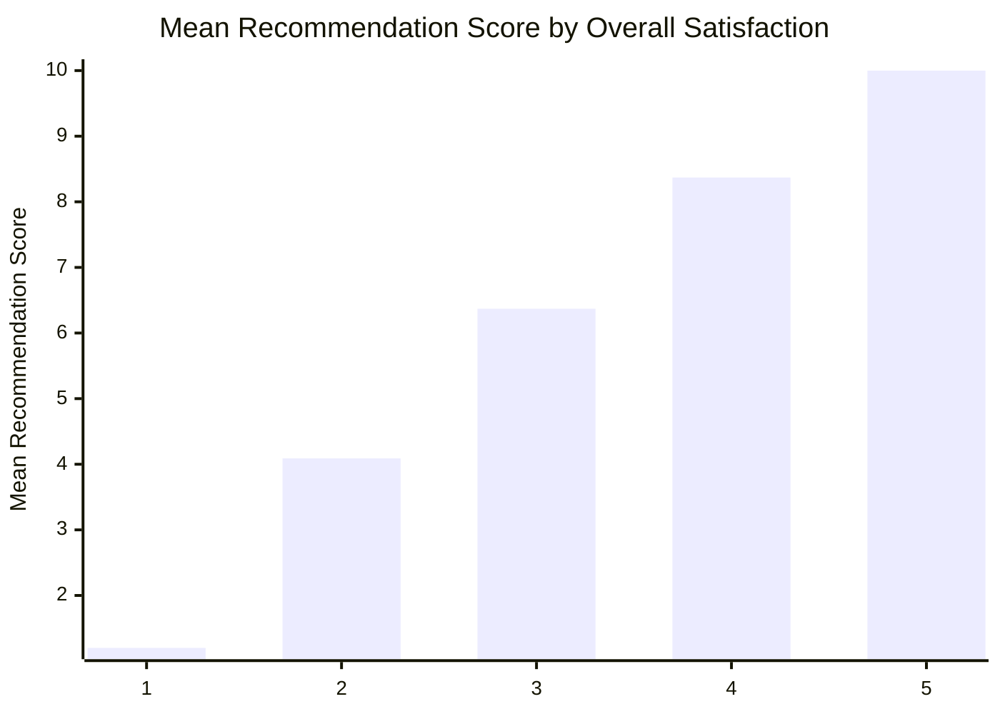

# Cross-Tabulation: Overall Satisfaction × Recommendation Score

**Verdict:** **STATISTICALLY SIGNIFICANT ($p < 0.05$)** — $\chi^2(40, N=240) = 651.33, p = 0.0000$, **Cramér's $V = 0.824$** (strong effect).

**Parametric / Non-Parametric Metric Test:** One-Way ANOVA (F) = `259.158`, $p = 0.0000$, **Eta-Squared (η²) = `0.8152`** (large) · Kruskal-Wallis (H) $p = 0.0000$.

**Dual Correlation:** Pearson $r = +0.898$ ($p = 0.0000$) · Spearman $\rho = +0.892$ ($p = 0.0000$) · Divergence $|\Delta| = 0.006$ (Linear alignment confirmed).

> **Margin Note:** Joint valid sample $N = 240$ (out of $N_{\text{total}} = 240$). $\chi^2 = 651.33, p = 0.0000$, Cramér's $V = 0.824$. Warning: 38 cells (69.1%) have expected count E_ij < 5.

## 1. Contingency Table (Row % ± 95% CI MoE & Subgroup $N$)

| Overall Satisfaction | Subgroup $N$ | ±MoE (95% CI) | 0 | 1 | 2 | 3 | 4 | 5 | 6 | 7 | 8 | 9 | 10 |
| :--- | ---: | ---: | ---: | ---: | ---: | ---: | ---: | ---: | ---: | ---: | ---: | ---: | ---: |
| **1** | 5 *(SMALL SAMPLE)* | — | **1 of 5** | **2 of 5** | **2 of 5** | 0 of 5 | 0 of 5 | 0 of 5 | 0 of 5 | 0 of 5 | 0 of 5 | 0 of 5 | 0 of 5 |
| **2** | 43 | ±14.9% | 0.0% (0) | 0.0% (0) | **7.0% (3)** | **14.0% (6)** | **46.5% (20)** | **27.9% (12)** | **4.7% (2)** | **0.0% (0)** | **0.0% (0)** | **0.0% (0)** | 0.0% (0) |
| **3** | 108 | ±9.4% | 0.0% (0) | 0.0% (0) | 0.0% (0) | 0.0% (0) | **1.9% (2)** | 13.0% (14) | **42.6% (46)** | **34.3% (37)** | **5.6% (6)** | **2.8% (3)** | **0.0% (0)** |
| **4** | 70 | ±11.7% | 0.0% (0) | 0.0% (0) | 0.0% (0) | 0.0% (0) | **0.0% (0)** | **0.0% (0)** | **1.4% (1)** | 8.6% (6) | **50.0% (35)** | **31.4% (22)** | 8.6% (6) |
| **5** | 14 *(SMALL SAMPLE)* | — | 0 of 14 | 0 of 14 | 0 of 14 | 0 of 14 | 0 of 14 | 0 of 14 | 0 of 14 | 0 of 14 | 0 of 14 | 0 of 14 | **14 of 14** |
| **Total / Base** | 240 | ±6.3% | 0.4% (1) | 0.8% (2) | 2.1% (5) | 2.5% (6) | 9.2% (22) | 10.8% (26) | 20.4% (49) | 17.9% (43) | 17.1% (41) | 10.4% (25) | 8.3% (20) |

## 2. Segment Performance on `Recommendation Score` (Parametric & Non-Parametric)

| Overall Satisfaction Segment | $N$ | Mean ± 95% MoE | SD | Median (IQR) | Sample Status |
| :--- | ---: | ---: | ---: | ---: | :--- |
| **1** | 5 | 1.20 (±0.73) | 0.84 | 1.00 (1.00) | SMALL SAMPLE (<30) |
| **2** | 43 | 4.09 (±0.28) | 0.95 | 4.00 (1.00) | Adequate (≥30) |
| **3** | 108 | 6.37 (±0.18) | 0.94 | 6.00 (1.00) | Adequate (≥30) |
| **4** | 70 | 8.37 (±0.19) | 0.82 | 8.00 (1.00) | Adequate (≥30) |
| **5** | 14 | 10.00 (±0.00) | 0.00 | 10.00 (0.00) | SMALL SAMPLE (<30) |

## 3. Significant Cell Deviations — Standardized Residuals ($|z_{ij}| \ge 1.96$)

| Segment Row | Outcome Column | Observed ($O_{ij}$) | Expected ($E_{ij}$) | Row % | Residual ($z_{ij}$) | Direction |
| :--- | :--- | ---: | ---: | ---: | ---: | :--- |
| **5** | 10 | 14 | 1.2 | 100.0% | **+11.88** | over-indexed |
| **1** | 1 | 2 | 0.0 | 40.0% | **+9.59** | over-indexed |
| **2** | 4 | 20 | 3.9 | 46.5% | **+8.09** | over-indexed |
| **1** | 0 | 1 | 0.0 | 20.0% | **+6.78** | over-indexed |
| **4** | 8 | 35 | 12.0 | 50.0% | **+6.66** | over-indexed |
| **1** | 2 | 2 | 0.1 | 40.0% | **+5.87** | over-indexed |
| **4** | 9 | 22 | 7.3 | 31.4% | **+5.45** | over-indexed |
| **3** | 6 | 46 | 22.1 | 42.6% | **+5.10** | over-indexed |
